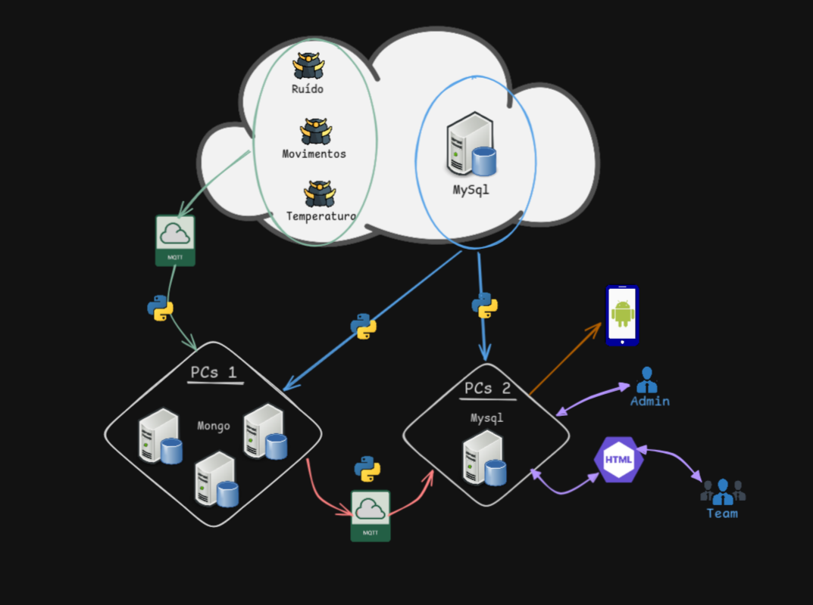

# PISID — Projeto Marsamis (mazerun)

<p align="center">
  
</p>

Mazerun is the PISID course project for monitoring the Marsamis maze. A simulator
(`mazerun.exe`) publishes movement, temperature, sound, and actuator events over
MQTT. A MongoDB layer ingests and validates the raw events, a MySQL persistence
service stores the processed history, and a React web dashboard plus an Android
app expose the data.

> **Academic project.** This repository is maintained for the PISID course at
> ISCTE. It is not published under an open-source license; all rights are
> reserved by the project authors.

## Components

| Component | Path | Responsibility |
| --- | --- | --- |
| Simulator | `game/server/mazerun.exe` (not tracked) | Publishes maze telemetry over MQTT |
| Ingest + processing | `mongo/` | MQTT → MongoDB, validation, change streams, retries, ACKs |
| Persistence | `mysql/persistence/` | Internal MQTT → MySQL |
| API | `mysql/php/` | REST API for the web dashboard and Android app |
| Web dashboard | `web-app/` | React + Vite monitoring UI |
| Android app | `android/` | Mobile monitoring UI |
| Database bootstrap | `mysql/db/` | Schema dump, procedures, roles |
| Helper scripts | `scripts/` | Dump generation |

## Quick start

### Prerequisites

- Docker Engine + Docker Compose v2
- Node.js 20+ and pnpm (only for local web development)
- Python 3.11+ (only for running the Python services outside Docker)
- Android Studio (only for the Android app)
- `mazerun.exe` and its `_internals/` folder (distributed separately by the course)

### 1. Configure secrets

```bash
cp mysql/.env.example mysql/.env
cp mongo/.env.example mongo/.env
cp mysql/persistence/.env.example mysql/persistence/.env
```

Edit `mysql/.env` and set at least:

- `JWT_SECRET` — generate with `openssl rand -hex 32`
- `CONSULTING_DB_*` — only if you need the course consulting database
- `MYSQL_*` — change the local defaults if you are not using a throwaway database

### 2. Start the MySQL + PHP stack

```bash
cd mysql
./run.sh        # Linux/macOS
# run.bat       # Windows
```

The script asks whether to recreate the database from `db/dump.sql`, then applies
the procedures and roles, and starts MySQL, phpMyAdmin, the PHP API, and the
persistence service.

### 3. Start the MongoDB stack

In a second terminal:

```bash
cd mongo
./run.sh
```

This starts the three-node replica set and the Python inbound/outbound
orchestrator.

### 4. Start the simulator

Place the executable at `game/server/mazerun.exe` (the PHP container mounts
`game/` at `/game`). You can then start a simulation from the web dashboard, or
run it manually:

```bash
./mazerun.exe 25 --flagMessage 1 --delay 2 --broker broker.hivemq.com --portbroker 1883
```

### 5. Start the clients

- **Web dashboard (Docker):** `cd web-app && ./run.sh` → <http://localhost:5173>
- **Web dashboard (local):** `cd web-app && pnpm install && pnpm dev`
- **Android:** open `android/` in Android Studio and run the app. For the
  emulator, use host `10.0.2.2:8000` and database `mazerun`.

## Repository layout

```text
.
├── android/              Android monitoring app
├── assets/               Diagrams used in the docs
├── docs/                 Architecture, setup, API, database and operations docs
├── mongo/                MongoDB ingest + processing services
├── mysql/                MySQL schema, PHP API and persistence service
│   ├── db/               Dump, procedures and roles
│   ├── persistence/      MQTT → MySQL worker
│   └── php/              Web API (web/) and legacy Android endpoints (android/)
├── scripts/              Dump generation helpers
├── web-app/              React dashboard
├── .env.example files    Per-service environment templates
└── README.md
```

`game/` is not tracked; it is the local mount point for the simulator and the
analytics executables.

## Documentation

- [Getting started](docs/getting-started.md)
- [Architecture](docs/architecture.md)
- [Data flow and MQTT topics](docs/data-flow.md)
- [Configuration and secrets](docs/configuration.md)
- [Database schema](docs/database.md)
- [HTTP API](docs/api.md)
- [Web app](docs/web-app.md)
- [Android app](docs/android.md)
- [Scripts](docs/scripts.md)
- [Troubleshooting](docs/troubleshooting.md)
- [Development and commit conventions](docs/development.md)
- [History rewrite / re-clone notice](docs/history-rewrite.md)

## Security

- Never commit `.env` files. Only `.env.example` templates are tracked.
- `JWT_SECRET` has no default; the PHP API refuses to start without it.
- The dump ships without a usable admin password hash. See
  [SECURITY.md](SECURITY.md) for the one-time setup.
- The default MQTT broker is public. Use a private broker for real deployments.

## License

Academic project. All rights reserved by the authors. See
[SECURITY.md](SECURITY.md) for contact and disclosure guidance.
