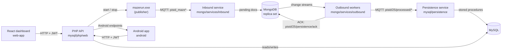

# Architecture

Mazerun is split into two data planes and three clients:

- **Ingest plane (MongoDB):** raw MQTT events from `mazerun.exe` are stored in
  MongoDB, validated, and re-published as normalized events.
- **Persistence plane (MySQL):** the normalized events are consumed and written
  to MySQL through stored procedures.
- **Clients:** the React dashboard and the Android app talk to the PHP API; the
  PHP API also starts and stops `mazerun.exe`.

## High-level flow



## Services

### MongoDB orchestrator — `mongo/main.py`

The entry point starts two child processes:

1. **Inbound** (`mongo/services/inbound/`)
   - Subscribes to the sensor, actuator, handshake, and simulation-finish topics.
   - Decodes JSON, Python literals, and the legacy `{Key:Value,...}` actuator
     payload.
   - Stamps documents with `simulation_id`, `player_id`, `process_status`,
     `sent_at`, and `processed_at`.
   - Registers active sessions in the `active_sessions` collection.
   - Terminates a session after a 5-minute timeout, when every Marsami has
     `status == 2`, or when `mazerun.exe` announces that the simulation finished.
   - Publishes the handshake ACK so the PHP API can start `mazerun.exe`.

2. **Outbound** (`mongo/services/outbound/`)
   - Watches MongoDB change streams for `moves`, `temperature`, `sound`,
     `rooms`, and `alerts`.
   - Validates moves against the `corridor` table, computes room occupation and
     alerts, and publishes normalized events on the internal topics.
   - Retries pending documents every 30 seconds.
   - Listens for MySQL persistence ACKs and marks documents as `processed`.

### Persistence service — `mysql/persistence/`

A single MQTT client subscribes to the internal topics and routes each payload
to a handler:

| Handler | Procedure |
| --- | --- |
| `MeasureHandler` | `sp_insert_measure` |
| `InvalidMeasureHandler` | `sp_insert_invalid_measure` |
| `TemperatureHandler` | `sp_insert_temperature` |
| `SoundHandler` | `sp_insert_sound` |
| `SoundOutlierHandler` | `sp_insert_sound_outlier` |
| `AlertHandler` | `sp_insert_alert` |
| `OccupationHandler` | `sp_update_ocupation` |
| `ActionHandler` | `sp_insert_action` |

After a successful write, the service publishes an ACK to
`pisid/25/persistence/ack`. The outbound `AckWorker` consumes it and marks the
MongoDB document as `processed`.

### PHP API — `mysql/php/`

- `web/api.php` — the JSON API used by the dashboard (`?action=...`).
- `web/simulation_finish_watcher.php` — a CLI watcher that waits for the
  `mazerun.exe` PID to exit, syncs the final score from the consulting database,
  and publishes the simulation-finished MQTT message.
- `android/*.php` — the legacy endpoints used by the Android app.
- `web/jwt.php` and `android/jwt.php` — HS256 JWT helpers. The secret is read
  from `JWT_SECRET` and has no fallback.

The PHP container includes Wine so it can launch the Windows `mazerun.exe`:

```text
MAZERUN_EXE_PATH=/game/server/mazerun.exe
```

### Web dashboard — `web-app/`

React 19 + Vite + React Router. It talks to the PHP API through
`VITE_API_URL`. The JWT is stored in `localStorage` and sent as a bearer token.

### Android app — `android/`

Java/Android app with four fragments (messages, Marsami room, sound,
temperature). The login screen collects the API host, database name, email, and
password. The token is kept in memory by `SessionManager`.

## Deployment topology

A typical course setup uses two machines:

```text
PC 1 (MongoDB + simulator)              PC 2 (MySQL + PHP + persistence)
┌─────────────────────────────┐         ┌──────────────────────────────┐
│ mongo-db / replica-1 / -2   │  MQTT   │ mysql-db                     │
│ mongo-app (inbound/outbound)│◄───────►│ mysql-app (persistence)      │
│ mazerun.exe                 │         │ php (Apache + Wine)          │
└─────────────────────────────┘         │ phpmyadmin                   │
                                        └──────────────────────────────┘
             ▲                                        ▲
             │                                        │
        MQTT broker                            HTTP + JWT
             ▲                                        ▲
             │                                        │
        ┌────┴─────┐                            ┌─────┴──────┐
        │ Web app  │                            │ Android app│
        └──────────┘                            └────────────┘
```

The services can also run on one machine; the only requirement is that the
containers can reach the same MQTT broker and that the PHP API can reach the
MySQL container.

## Ports

| Service | Host port | Notes |
| --- | --- | --- |
| MongoDB primary | `27017` | Replica set `rs0` |
| MongoDB secondary 1 | `27018` | |
| MongoDB secondary 2 | `27019` | |
| MySQL | `3306` | |
| phpMyAdmin | `8080` | |
| PHP API | `8000` | `http://localhost:8000/web/api.php` |
| Web app (Vite) | `5173` | |
| MQTT broker | `1883` | Public `broker.hivemq.com` by default |

## Related docs

- [Data flow and MQTT topics](data-flow.md)
- [Database schema](database.md)
- [HTTP API](api.md)
- [Configuration](configuration.md)
