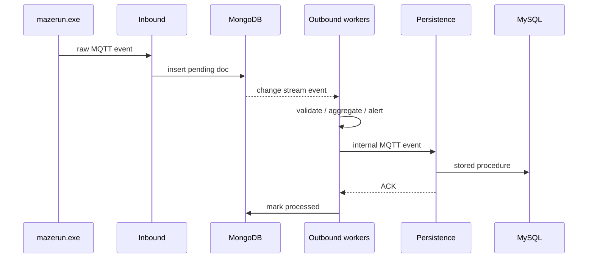

# Data flow and MQTT topics

## Overview

1. `mazerun.exe` publishes raw telemetry on the public sensor topics.
2. The inbound service writes each payload to MongoDB with
   `process_status: "pending"` and stamps it with the active
   `player_id`/`simulation_id`.
3. MongoDB change streams wake the outbound workers, which validate and
   normalize the documents, update the aggregated `rooms` collection, generate
   alerts, and publish internal events.
4. The persistence service consumes the internal events and writes them to
   MySQL through stored procedures.
5. The persistence service publishes an ACK; the `AckWorker` marks the MongoDB
   document as `processed`.



## Input topics

The topic names are configured in `mongo/config.yaml`. The current team is
`25`; replace `25` if you use a different team.

| Topic | QoS | Collection | Payload |
| --- | --- | --- | --- |
| `pisid_mazemov_25` | 1 | `moves` | Movement from one room to another |
| `pisid_mazetemp_25` | 1 | `temperature` | Temperature reading |
| `pisid_mazesound_25` | 0 | `sound` | Sound reading |
| `pisid_mazeact` | 0 | `actions` | Actuator/action event |
| `pisid/25/game/start` | 0 | `active_sessions` | Handshake from the PHP API |
| `pisid/25/simulation/finished` | 0 | `active_sessions` | Simulation finished |

The inbound service also accepts the legacy unprefixed topics `game/start` and
`simulation/finished`.

### Payload examples

Movement:

```json
{
  "Marsami": 123,
  "RoomOrigin": 1,
  "RoomDestiny": 2,
  "timestamp": "2026-05-21T14:03:11",
  "Player": 25
}
```

Temperature:

```json
{
  "Sensor": "T1",
  "Value": 25.4,
  "timestamp": "2026-05-21T14:03:11",
  "Player": 25
}
```

Sound:

```json
{
  "Sensor": "S1",
  "Value": 35.0,
  "timestamp": "2026-05-21T14:03:11",
  "Player": 25
}
```

Action:

```json
{
  "Action": "OPEN_DOOR",
  "Value": 1,
  "timestamp": "2026-05-21T14:03:11",
  "Player": 25
}
```

The inbound decoder accepts JSON, Python literal dictionaries, and the legacy
`{Key:Value,...}` actuator format.

Handshake:

```json
{
  "player_id": 25,
  "simulation_id": 50,
  "handshake_id": "a-uuid",
  "numbermarsamis": 30
}
```

The inbound service replies on `pisid/25/game/start/ack`:

```json
{
  "player_id": 25,
  "simulation_id": 50,
  "handshake_id": "a-uuid"
}
```

## Internal topics

The outbound workers publish on the prefix configured by
`mqtt.internal_prefix` (default `pisid/25/processed`).

| Topic | Producer | Consumer |
| --- | --- | --- |
| `pisid/25/processed/measure` | Movement worker | Persistence |
| `pisid/25/processed/invalid_measure` | Movement worker | Persistence |
| `pisid/25/processed/temperature` | Temperature worker | Persistence |
| `pisid/25/processed/sound` | Sound worker | Persistence |
| `pisid/25/processed/sound_outlier` | Sound worker | Persistence |
| `pisid/25/processed/message` | Alert worker | Persistence |
| `pisid/25/processed/ocupation` | Room worker | Persistence |
| `pisid/25/persistence/ack` | Persistence | `AckWorker` |
| `actuator/score` | Room worker | Score display / debug |
| `pisid_mazeact` | Actuator worker | Actuator hardware |

Verification failures from the sound and temperature workers are still
published to the legacy topic `processed/invalid`, which is not consumed by the
persistence service. Check the container logs if a reading seems to disappear.

## Document lifecycle (`process_status`)

| Status | Meaning |
| --- | --- |
| `pending` | Written by inbound; waiting for an outbound worker |
| `processing` | Claimed by a worker; `sent_at` is set |
| `processed` | MySQL acknowledged; `processed_at` is set |

The `RetryWorker` looks for documents that remain `pending`/`processing` for
too long and re-queues them. The `AckWorker` moves documents to `processed`
when the persistence service confirms the write.

## Session termination

The inbound service removes the `active_sessions` document when any of these
conditions is met:

1. The session has been idle for 5 minutes.
2. Every Marsami in the simulation has `status == 2` (tired).
3. `mazerun.exe` exits; the PHP watcher publishes
   `pisid/25/simulation/finished`.

The session timeout logic lives in
`mongo/services/inbound/processor.py`.

## MQTT client details

- Broker: `broker.hivemq.com:1883` by default (public).
- The internal prefix isolates this team's processed events from other teams
  using the same public broker.
- The inbound client uses QoS 1 for movement and temperature, QoS 0 for sound
  and actuators.
- The persistence client publishes an ACK only after the MySQL procedure
  succeeds.

## Related docs

- [Architecture](architecture.md)
- [Database schema](database.md)
- [Configuration](configuration.md)
